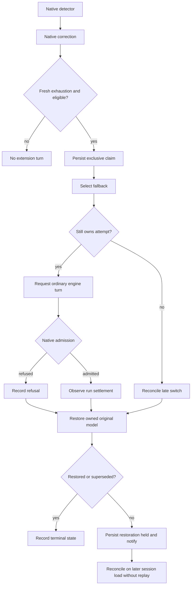

# Repetition Recovery Reliability - Plan

## Goal Capsule

- Objective: Let work stalled by repeated model output resume once on an explicitly selected fallback, without requiring another user message.
- Means: Harden `extensions/repetition-recovery` around the existing native detector, durable claim, and session model APIs.
- Authority: This document proposes implementation. It does not authorize changing the installed host or activating recovery in existing sessions.
- Execution profile: Small changes to the current extension and its existing tests. No new framework, dependency, detector, or provider retry policy.
- Stop condition: Every requirement has deterministic regression coverage, the pinned engine demonstrates bounded admission and restoration, and repository checks pass.

---

## Product Contract

### Summary

Keep the existing explicit fallback flag and one-attempt policy. Make activation and terminal outcomes observable, restrict recovery to a newly exhausted correction in the current run, and fix lifecycle races that can leave the session on the fallback model. Use historical failures as regression scenarios without copying private transcripts into the repository.

### Problem Frame

The local audit found nine native repetition stops across eight sessions. Several resumed only after manual continuation or another user message. No historical extension admission or recovery journal was found, so these records establish missed opportunities for recovery, not proof that the extension itself failed in production. Most other observed failures came from providers, tool arguments, missing files, or operational state and have no repetition-exhaustion signal.

### Requirements

**Eligibility and bounds**

- R1. Preserve native detection and its first correction, then allow at most one extension continuation per session/latest-user-entry pair after a fresh supported exhaustion in the active branch.
- R2. Require an explicit `--repetition-recovery-model provider/model` selector and a distinct available model, with no automatic default or persistent provider-setting changes.
- R3. Never recover from user cancellation, a deadline, an old exhaustion discovered on load, or a non-repetition error alone. New input and competing pending messages supersede the attempt.
- R4. Use ordinary native continuation admission and preserve all engine caps, context, and history. Never call `sendUserMessage`, impersonate manual continuation, or replay a claimed attempt.

**Lifecycle and evidence**

- R5. Restore the original model after settlement, refusal, interruption, or an interrupted model switch, without overwriting a newer explicit model choice.
- R6. Persist restoration failure separately from continuation outcome so reopening can reconcile the model without requesting another continuation.
- R7. Keep private metadata-only journals and distinguish requested, admitted, settled, repeated, refused, interrupted, and restoration-held outcomes. A settled model run must not be described as completed user work.
- R8. Show concise activation and held-recovery diagnostics through existing extension UI notifications, including disabled-without-selector, invalid selector, pending input, engine refusal, and restoration failure.

### Scope boundaries

Provider connection failures, subscription quotas, tool-call correction, LSP failures, child-routing errors, host restarts, and tool-loop notices remain outside automatic recovery eligibility. They are retained in the evidence map below so they cannot silently become fallback triggers. No generic failure scanner, tool replay, transcript rewriting, global installation, model cascade, or automatic journal deletion is proposed.

---

## Planning Contract

### Historical evidence and coverage

The November 5 audit inspected 96 historical session JSONL files containing 46,269 records, dated September 23, 07:48:11 UTC through November 5, 19:14:30 UTC. The inventory includes 61 main-store sessions and 35 child sessions, including retained worktree stores. Fifteen valid files have no messages. All records parsed. Goal-history files, unrelated `.pi` stores, the active investigation, and its audit child were excluded. The `.senpi` store was absent.

References use unique session-ID prefixes and physical JSONL line numbers. They can be resolved locally by session filename under the OMO session and project child stores. Full transcripts and machine-specific paths remain local.

| Evidence | Observed count | Representative citation | Treatment |
| --- | ---: | --- | --- |
| TTSR activations | 33 | `01a1583e:L17-L29` | Native detector remains owner. |
| Native corrections | 24 in 17 sessions | 23 collapse, 1 repetitive-turns | Preserve the native first attempt. |
| Exhaustion and repetition pauses | 9 in 8 sessions | Detailed chronology below | R1 recovery candidates, subject to R2-R4. |
| Provider errors | 26 in 8 sessions | `01a0d4ea:L3600-L3638` | No extension continuation from error alone. |
| Assistant aborts | 99 in 23 sessions | 33 follow TTSR activations | Do not infer user cancellation from `aborted` alone. |
| Flagged tool-result errors | 248 in 26 sessions | `01a0cd3c:L81,L118,L284,L342,L406` | Correct tool/data causes outside this extension. |
| Tool-loop notices | 23 | 7 identical, 16 similar | Warnings are not exhaustion. |
| Manual continuations | 5 | `01a176e7:L26,L54`, `01a1a8e1:L43` | Evidence of intervention, never an API to emulate. |
| Host restart interruptions | 3 tickets in one run | `01a19d90:L7539-L7552` | Native work custody owns resume. |
| Confirmed extension admissions / engine-cap events | 0 / 0 | No recovery journal directory found | No production recovery-rate claim. |

Counts overlap. The 248 flagged errors comprise 107 patch failures, 54 file/read-offset failures, 10 argument failures, 12 LSP failures, 19 task-state failures, 2 routing failures, 2 terminal failures, 6 retrieval failures, 7 memory-write failures, 4 browser failures, 2 external-thread failures, 5 goal-state failures, 16 shared-memory-input failures, and 2 directory/identity failures. Thirteen groups contain 45 repeated identical error results. These observations establish repeated bad calls, not successful repairs.

The 26 provider errors comprise 3 WebSocket 1006, 1 WebSocket 1012, 9 subscription-limit errors, 2 upstream-connection losses, 2 stream-start timeouts, and 9 generic connection errors. Several resumed automatically. Nine subscription-limit failures repeated to transcript end, demonstrating why more automatic continuation does not itself solve provider failure.

All 203 additional unflagged tool-output candidates were adjudicated at record granularity. Of these, 151 contain actual failures, 39 contain intentional failure receipts, and 13 are quotations or readbacks. Mixed records use the actual-failure classification when they also contain a live error. These are result-record counts, not distinct incidents, and must not be summed with provider-error counts.

The 151 actual records comprise 111 nested tool-error records, 8 caught read-error records, and 32 ordinary command/test failure records. The nested records contain 130 envelopes: 109 missing paths, 13 invalid offsets, 6 task-name mismatches, and 2 permission denials. The 32 command/test records comprise 8 test/qualification, 7 typecheck/build, 4 browser QA, 6 script/syntax/module/shell, 3 fixture/process/smoke, 1 database restore, 1 missing deployment file, and 2 connection/desktop-socket failures. Representative citations are `01a1640c:L39,L49`, `01a19d90:L4096,L5940,L6190`, `01a19e76:L935,L3042`, and `01a0d4ea:L1540,L2434,L2526,L2946`. None establishes a new repetition-exhaustion trigger.

The 39 intentional receipts comprise 34 failing-first proofs, 3 mutation controls, 1 injected fault, and 1 expected preflight refusal. Examples are `01a0d4ea:L678,L871,L889,L940,L3376,L3391,L3408,L3539`. They must not inflate the production failure inventory.

| Session | Exhaustion UTC | Recorded outcome |
| --- | --- | --- |
| `01a1461c` | Oct 16, 19:07:25 | Injection L19, abort L21, stop/pause L23-L24. No later recovery recorded. |
| `01a1583e` | Oct 20, 07:37:43 | Injections L19/L24, stop L28. User L37 and resumed work L38 on Oct 22. |
| `01a176e7` | Oct 26, 06:30:58 | Stop L24, manual continuation L26, resumed work L27. |
| `01a18d3b` | Oct 30, 14:34:41 | Stop L32, user L41, another abort L44, correction L54, resumed work L56. |
| `01a19e80` | Nov 2, 23:03:46 | Stop L30, user L39, abort L42, correction L52, resumed work L54. |
| `01a1a891` | Nov 4, 21:58:27 | Stop L32, manual continuation L42, user L44, abort L46, correction L57, resumed work L59. |
| `01a1a8e1` | Nov 4, 23:25:36 / 23:25:47 | Stops L32/L50 share the same user entry. Manual continuation L43 repeated the failure. User L57 preceded resumed work L58. |
| `01a1ad21` | Nov 5, 19:14:28 | Injection L25, abort L29, stop/pause L32-L33. No recovery before transcript end. |

All nine stops meet the current rule/injection evidence test, but represent eight session/user pairs. Availability of a distinct authenticated fallback and native admission at those historical moments cannot be reconstructed. Therefore eight is the maximum number of candidate attempts, not eight preventable failures or guaranteed successes.

The excluded active session independently repeated the pattern: `01a1ad24:L26,L33-L34,L44,L46` records correction, exhaustion, manual continuation, and resumed tool use. It is not included in the historical counts.

Coverage is limited to available local stores. Deleted, remote, and undiscovered custom stores are unobserved. Older abort records do not reliably identify their source. No candidate record remains classification-ambiguous, but causes and unique execution counts cannot always be recovered from mixed or filtered output. For example, `01a19e76:L4548` records an `AbortError` without establishing its cause. No production recovery success rate can be calculated.

### Source-backed findings

- F1. Activation is silent without the flag: `extensions/repetition-recovery/src/index.ts:23` returns before creating recovery. Package configuration and compiled cache entries prove discovery, not activation. The missing journal and zero admissions are consistent with inactivity, but cannot prove historical launch arguments.
- F2. Eligibility scans the entire latest-user tail in `extensions/repetition-recovery/src/recovery.ts:175`, so a later unrelated settlement can discover an old unclaimed stop. This contradicts the README's intended absence of historical recovery. This is a source-derived risk, not an observed production fallback.
- F3. The awaited model selection at `extensions/repetition-recovery/src/recovery.ts:239` can finish after `interrupted()` clears the attempt. The identity check prevents sending a continuation but does not compensate for the late switch. The old context can still report the original model when interruption tries restoration.
- F4. Restoration failure only warns at `extensions/repetition-recovery/src/recovery.ts:74`, after which callers write a terminal outcome. `resumed()` skips terminal outcomes at line 90, and `src/journal.ts:92` drops the outcome on read. A failed restore can therefore become unreconcilable by the current protocol.
- F5. `extensions/repetition-recovery/src/index.ts:61` classifies a run with no assistant error as `completed`. That is a run observation and cannot establish completion of the user's task.

### Compatibility authority

Verified by source inspection on November 5, 2026: repository OMO `5.1.60` and Senpi `2026.11.2-3`; current host binary OMO `5.1.60`; mise Bun `1.3.14`. No tests were run during planning.

- S1. [OMO release pairing](https://github.com/code-yeongyu/oh-my-openagent/blob/9cfa9cc7f7c86f972b9b6513d526ca9d427e4109/packages/omo-native/package.json).
- S2. [Senpi native guard and exhaustion event](https://github.com/code-yeongyu/senpi/blob/92314cc4be884337a2547f66b788fd2b6acc94e1/packages/coding-agent/src/core/extensions/builtin/ttsr/index.ts).
- S3. [Durable native correction limit](https://github.com/code-yeongyu/senpi/blob/92314cc4be884337a2547f66b788fd2b6acc94e1/packages/coding-agent/src/core/extensions/builtin/ttsr/follow-up-limit.ts).
- S4. [Native settlement and turn admission](https://github.com/code-yeongyu/senpi/blob/92314cc4be884337a2547f66b788fd2b6acc94e1/packages/coding-agent/src/core/agent-session.ts).
- S5. Local implementation and existing proof contract: `extensions/repetition-recovery/README.md`, `src/index.ts`, `src/recovery.ts`, `src/journal.ts`, `test/recovery.test.ts`, and `test/engine.test.ts`, all under `extensions/repetition-recovery/`.

Senpi owns the lifecycle behavior being changed. OMO applies only to package discovery, launch arguments, and release pairing. Revalidate both boundaries before implementation if either installed or repository versions change. Existing deterministic engine tests describe prior proof, not a fresh result from this investigation.

### Key Technical Decisions

- KTD1. Keep the current explicit selector and existing package entrypoint for R2. Add notifications instead of new configuration storage, a launcher wrapper, or automatic model choice.
- KTD2. Arm recovery only for a fresh `ttsr:loop-stopped` event observed during the current run, correlated with its new branch entry, supported rule, and prior native injection for R1/R3. Snapshot existing entries on session load and each run start. Evaluate at `agent_settled` after native TTSR publishes exhaustion. Verify handler ordering in the actual SDK rather than moving to the earlier `agent_before_settle` boundary where exhaustion is not yet published.
- KTD3. Keep exclusive flushed claims and the existing journal key for R4. A stale event does not consume a claim. Once claimed, an attempt remains spent even when admission or model selection fails.
- KTD4. Make model-selection ownership explicit for R5/R6. Capture the attempt before awaiting selection, invalidate it on interruption, and reconcile a late successful switch before returning. Refresh the model from the live context before restoration. Restore only the fallback still owned by that attempt, preserving any newer explicit selection.
- KTD5. Track continuation outcome and restoration state independently in the existing private journal for R6/R7. Preserve legacy claim files. A legacy terminal outcome is already spent and must not be replayed or assumed to prove restoration. New restoration-held records remain reconcilable on session load, with no timer or automatic continuation retry.
- KTD6. Normalize journal fields on read and write from an explicit metadata allowlist for R7. Store outcome and restoration state without arbitrary errors or detector payloads. Keep existing file modes, correlation scheme, and durable claims.

### Lifecycle

### Assumptions and limits

Fallback models may share the same gateway and failure domain. A different model might escape output collapse but does not guarantee useful progress. Model availability and authentication must be checked using supported registry/selection behavior at implementation time. No provider requests or host settings are changed by this plan.

---

## Implementation Units

### U1. Restrict recovery to fresh native exhaustion

- Goal: Implement R1/R3/R4 using KTD2/KTD3.
- Dependencies: None.
- Files: `extensions/repetition-recovery/src/index.ts`, `extensions/repetition-recovery/src/recovery.ts`, `extensions/repetition-recovery/test/recovery.test.ts`, `extensions/repetition-recovery/test/engine.test.ts`.
- Approach: Pass current-run exhaustion evidence into the existing recovery object. Preserve the native detector and claim protocol. Refresh branch/user identity and pending-message state before requesting a turn.
- Test scenarios: Native correction succeeds with no fallback. Fresh supported exhaustion produces one claim. Loading an old stop and settling unrelated work produces none. Two stops for the same user pair produce one attempt. An unsupported rule, missing correction, different branch, user abort, deadline, new input, or competing pending message produces no continuation.
- Verification: Targeted regression suite passes, including real SDK handler ordering. Historical chronology becomes synthetic metadata fixtures, never full transcript copies.

### U2. Make interruption and restoration converge

- Goal: Implement R5/R6 with KTD4/KTD5.
- Dependencies: U1.
- Files: `extensions/repetition-recovery/src/recovery.ts`, `extensions/repetition-recovery/src/journal.ts`, `extensions/repetition-recovery/src/index.ts`, `extensions/repetition-recovery/test/recovery.test.ts`.
- Approach: Keep this lifecycle inside the existing recovery object. Serialize or invalidate transitions around the awaited model selection and use a fresh context for reconciliation. Separate a spent continuation from an outstanding restoration obligation. Preserve legacy files without clearing claims.
- Test scenarios: Defer fallback selection, interrupt, resolve selection, and observe original model restored with zero sends. Cover input, shutdown, and session abort. Explicit newer model selection survives cleanup. Original model missing or rejected leaves restoration-held evidence. Reload can restore a held new-format record without replay. Legacy terminal and malformed records never replay. Storage failure before claim produces no model switch.
- Verification: Each asynchronous ordering has a deterministic test, with one claim, at most one send, and an explicit final model/restoration state.

### U3. Expose activation and truthful recovery outcomes

- Goal: Implement R2/R7/R8 using KTD1/KTD6.
- Dependencies: U2.
- Files: `extensions/repetition-recovery/src/index.ts`, `extensions/repetition-recovery/src/recovery.ts`, `extensions/repetition-recovery/src/journal.ts`, `extensions/repetition-recovery/test/recovery.test.ts`, `extensions/repetition-recovery/test/engine.test.ts`.
- Approach: Use existing notifications for activation and held outcomes. Replace ambiguous completion wording with settled-run wording. Keep diagnostics bounded to metadata. Do not add a command suite or persistent config file.
- Test scenarios: Missing/empty flag remains disabled and observable. Unknown/same model selector reports no usable fallback. Request without `agent_start` never records admission. Cap refusal and recurrence have separate outcomes. Journal round-trip preserves the allowlisted restoration/outcome fields and strips unknown fields. Seed private-text sentinels and prove none enter journals or notices.
- Verification: Unit assertions cover every diagnostic branch. Real SDK scenarios preserve primary/primary/fallback when admitted and primary/primary when capped, followed by original-model restoration.

### U4. Verify the pinned runtime and document opt-in use

- Goal: Deliver the supported extension behavior with traceable verification.
- Dependencies: U1-U3.
- Files: `extensions/repetition-recovery/test/engine.test.ts`, `extensions/repetition-recovery/README.md`, `extensions/repetition-recovery/AGENTS.md`, `docs/upstream-validation.md`, `docs/issues.md`; update root `AGENTS.md` only if its extension contract changes.
- Approach: Follow `docs/upstream-validation.md`. Refresh immutable source evidence and record runtime versions. Document the existing flag, new diagnostics, legacy-journal limits, and the distinction between recovery settlement and task success. Record the reported repetition problem and implemented resolution without rewriting historical results.
- Test scenarios: Both supported rules reach the same bounded path. Native correction, recurrence, unchanged cap refusal, interrupted selection, reload, and restoration failure are covered through the appropriate unit or SDK boundary. Verify extension discovery and flag acceptance through the pinned CLI in an isolated agent directory with the deterministic provider.
- Verification: Run the commands below. Production smoke observation is optional and separately authorized, with no claim that synthetic success predicts a real-provider success rate.

---

## Verification Contract

These checks belong to implementation. They were not executed while writing this plan.

| Check | Applies to | Passing evidence |
| --- | --- | --- |
| `bun test --timeout 30000 ./extensions/repetition-recovery/test` | U1-U4 | Fresh eligibility, asynchronous races, journal compatibility/privacy, SDK admission and restoration pass. |
| `bun run typecheck` | U1-U3 | Public SDK lifecycle and model types compile. |
| `bun run validate:package` | U4 | Package discovery/import boundaries remain valid. |
| Pinned CLI isolated-agent scenario | U4 | Explicit flag is accepted and diagnostics identify enabled/disabled state without global writes. |
| `mise ci` | U4 | Full repository package, tests, build, quality, and hook checks pass. |

## Definition of Done

- Every R-ID maps to a passing scenario in U1-U4, including zero-extension-turn negative cases.
- The primary/primary/fallback path admits at most one fallback and restores the original model. Native cap refusal produces no fallback provider call.
- Cancellation during an awaited switch cannot leave an unowned fallback selection. Restoration failure remains visible and reconcilable without replay.
- Existing claim files retain their at-most-once meaning. New journal fields contain only approved metadata.
- DOX and upstream evidence agree with implemented behavior. No credentials, raw transcript excerpts, or host paths are committed.
- Verified atomic Conventional Commits are created under repository policy. Remote pushes and host activation require separate authorization.
